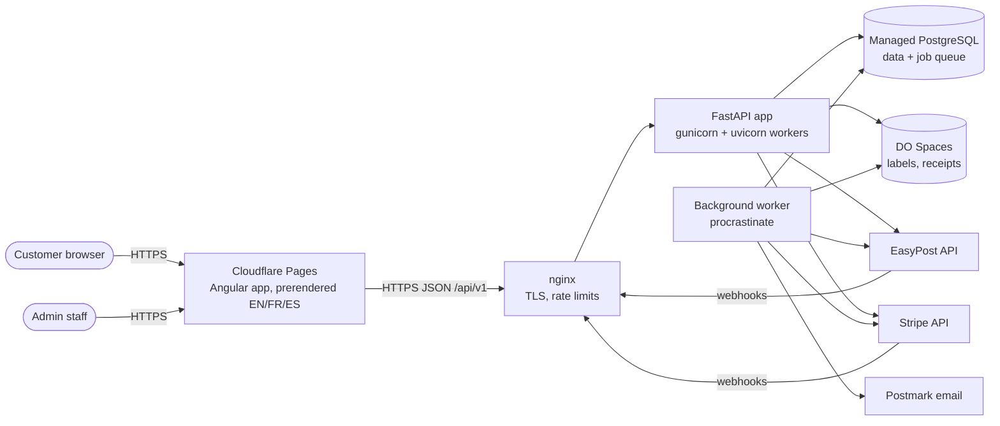
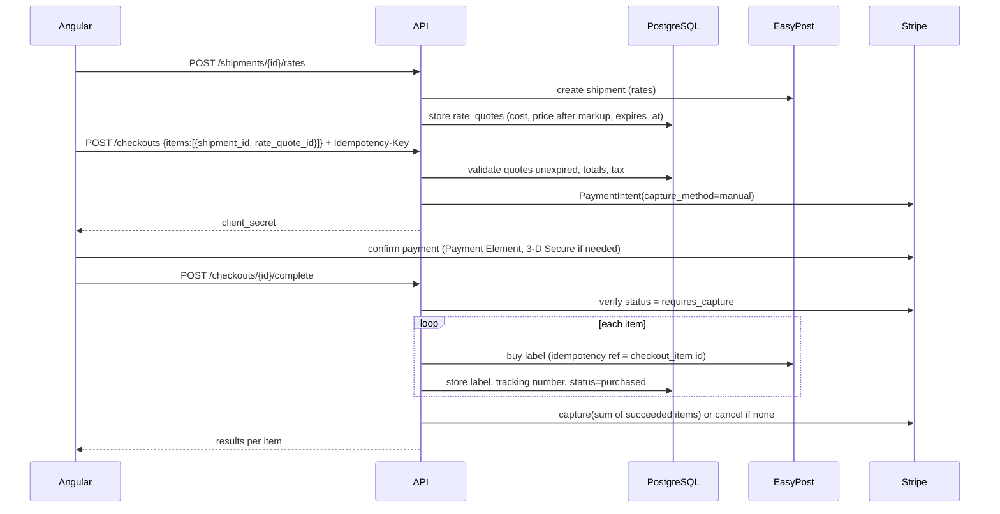

# System Architecture

## 1. Context



Single droplet at launch hosting nginx, the API service and the worker service. The database is
managed and separate. Scaling path: add droplets behind a DO load balancer; the API is stateless
and the worker can run on its own droplet. Nothing in the design assumes a single machine.

## 2. Backend structure: modular monolith

One FastAPI deployable, split into domain modules with explicit boundaries. Modules talk to
each other through service functions, never by reaching into another module's tables.
This keeps deployment simple now and leaves a clean seam to extract services later
(e.g. warehouse) if ever needed.

```
app/
  core/          config, db session, security, i18n, errors, logging, pagination
  modules/
    identity/    users, auth, MFA, sessions, RBAC
    accounts/    billing accounts, membership, addresses, preferences
    shipping/    shipments, parcels, customs, rating, labels, state machine
    tracking/    tracking events, normalized statuses, public tracking
    payments/    checkouts, payments, refunds, receipts, tax
    pricing/     markup rules
    notifications/ email templates, preferences, outbox
    admin/       admin endpoints, reports, settings
    audit/       append-only audit log
  integrations/
    shipping_providers/  base.py (interface), easypost/, mock/
    payment_providers/   base.py (interface), stripe/, mock/
    email/               base.py, postmark/, console/
    storage/             base.py, spaces/, local/
  jobs/          procrastinate task definitions (thin; call module services)
```

Each module has the same internal layout: `models.py` (SQLAlchemy), `schemas.py` (Pydantic),
`repository.py` (queries), `service.py` (business logic), `router.py` (HTTP), `tests/`.

## 3. Integration adapters

### Shipping provider interface
```python
class ShippingProvider(Protocol):
    code: str                                   # "easypost", "mock"
    def capabilities(self, carrier: str) -> CarrierCapabilities: ...
    async def verify_address(self, addr: AddressIn) -> AddressVerification: ...
    async def get_rates(self, req: RateRequest) -> list[ProviderRate]: ...
    async def buy_label(self, req: BuyLabelRequest) -> PurchasedLabel: ...   # idempotent on our reference
    async def void_label(self, ref: ProviderShipmentRef) -> VoidResult: ...
    async def get_tracking(self, ref: TrackingRef) -> TrackingSnapshot: ...
    def parse_webhook(self, headers, body: bytes) -> list[ProviderEvent]: ...  # verifies signature
```
`CarrierCapabilities` covers: `can_void`, `void_window`, `supports_pickup`,
`supports_signature`, `supports_insurance`, `label_formats`.

All provider responses are converted into internal DTOs at the adapter boundary. No EasyPost
types leak outside `integrations/shipping_providers/easypost/`.

### Payment provider interface
```python
class PaymentProvider(Protocol):
    code: str                                   # "stripe", "paypal", "mock"
    async def ensure_customer(self, account) -> str: ...
    async def authorize(self, req: AuthorizeRequest) -> Authorization: ...  # returns client secret
    async def get_status(self, provider_payment_id) -> PaymentStatus: ...
    async def capture(self, provider_payment_id, amount) -> Capture: ...
    async def cancel(self, provider_payment_id) -> None: ...
    async def refund(self, provider_payment_id, amount, reason) -> Refund: ...
    async def calculate_tax(self, req: TaxRequest) -> TaxResult: ...
    def parse_webhook(self, headers, body: bytes) -> list[ProviderEvent]: ...
```

### Test vs live (no simulated data shown as real)
- `APP_MODE` = `development` | `sandbox` | `production`.
- `development` may use `mock` adapters (offline, deterministic). `sandbox` uses EasyPost test
  keys and Stripe test keys. `production` uses live keys and refuses to start with mock adapters.
- Every quote, shipment, label and payment row stores `is_test`. The UI shows a persistent
  "TEST MODE: labels are not valid for shipping" banner whenever `is_test` data is shown. Mock
  rates are labelled "Simulated" in the UI and API (`source: "mock"`).

## 4. Key flows

### 4.1 Quote → checkout → labels (D-010, D-011)

Safety net: the Stripe webhook `payment_intent.amount_capturable_updated` also enqueues
`complete_checkout`. The job is idempotent (row lock on the checkout), so whichever path arrives
first does the work and the other is a no-op. A scheduled job completes or cancels checkouts
stuck in `authorized` for over 15 minutes.

### 4.2 Tracking
EasyPost `tracker.updated` webhook → stored in `webhook_events` (deduplicated by event id) →
job normalizes events into `tracking_events` → updates shipment `tracking_status` → sends
notification if the user opted in. A daily poll job refreshes active shipments with no update
for 48 h (covers missed webhooks).

### 4.3 Void / refund
Allowed only when the carrier capability says `can_void` and within the void window.
`POST /shipments/{id}/void` → provider void request → status `void_requested` → provider confirms
(some carriers take days) → Stripe refund of the label price → status `voided`.
Stripe does not return its processing fee on refunds; this cost is tracked in reporting.

## 5. Frontend architecture

- Angular (current stable at project start, pinned), standalone components, signals for local
  state, RxJS for HTTP/streams, Reactive Forms, lazy-loaded route areas:
  `public/`, `auth/`, `portal/`, `admin/`.
- **i18n:** `@angular/localize`, one build per locale, served at `/en/`, `/fr/`, `/es/`.
  Public marketing routes are prerendered (static HTML) for SEO, with `hreflang` tags. Portal and
  admin are client-rendered. Root `/` redirects by `Accept-Language` (Cloudflare Pages function or
  `_redirects`), with a remembered choice.
- **Auth in the browser:** access token (15 min) held in memory only; refresh token in an
  `HttpOnly; Secure; SameSite=Strict` cookie scoped to `/api/v1/auth`. An HTTP interceptor refreshes
  silently on 401. Frontend (`velox.example`) and API (`api.velox.example`) share a registrable
  domain, so the cookie is same-site.
- Admin area is the same Angular app behind role guards. The server enforces all permissions; the
  guards only hide UI.

## 6. Cross-cutting concerns

| Concern | Approach |
|---|---|
| Config | Pydantic Settings from environment / `.env` (never committed). `.env.example` documents keys. |
| Secrets | Server env files (`chmod 600`, owned by service user); provider keys never in DB plaintext. |
| Errors | One error envelope `{error:{code,message,details,request_id}}`; `code` is stable and translated client-side. |
| Logging | Structured JSON logs (stdlib logging + `python-json-logger`) with `request_id`; PII redaction filter. |
| Monitoring | Sentry (errors, frontend + backend), DO uptime checks on `/health` and `/ready`. |
| Rate limiting | nginx `limit_req` per IP (coarse) + DB-backed per-account counters for login, quote and tracking endpoints. |
| Idempotency | `Idempotency-Key` header required on checkout creation/completion; stored with request hash and response. |
| Time | All timestamps `TIMESTAMPTZ` in UTC; displayed in the user's timezone. |
| Migrations | Alembic only; every schema change ships with a migration and a downgrade. |
| CI | GitHub Actions: ruff, mypy, pytest (against real PostgreSQL service), Angular lint/test/build, Playwright smoke. |
| Backups | Managed PG daily backups + PITR (7 days); weekly logical dump to Spaces (30-day retention); restore drill each quarter. |

## 7. Security model (summary; detail in `02-technical-spec.md` §6)

- Passwords: Argon2id. MFA: TOTP + one-time recovery codes.
- Refresh token rotation with reuse detection (token family revoked on reuse).
- RBAC: roles → permissions; every admin endpoint declares a required permission.
- Account-scoped data access enforced in repositories (every customer query filters by
  `account_id`), and tested with cross-account access tests.
- Webhooks: signature verification (Stripe signing secret, EasyPost HMAC), replay dedupe.
- Strict CSP on the frontend, no inline scripts; Angular's built-in sanitization; no
  `innerHTML` with user data.
- Audit log for authentication events, admin actions, payments, refunds, voids, setting changes.
