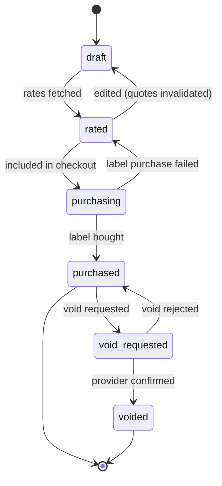

# Technical Specification

## 1. MVP scope (first paid launch)

### In scope
| Area | Features |
|---|---|
| Public website | Homepage with rate calculator, Shipping Services, Carriers, US↔Canada Shipping, Business (lead form), About, FAQ, Contact, Privacy, Terms, public Tracking; EN/FR/ES |
| Accounts | Register, email verification, login, logout, password reset/change, optional TOTP MFA, profile, language/currency preference, notification preferences |
| Address book | CRUD, default sender, address verification |
| Shipments | Guided create (sender, recipient, parcel, options), drafts, US domestic, CA domestic, US↔CA with customs |
| Rates | Rate comparison across carriers via EasyPost, markup applied, expiry |
| Checkout | 1–N labels in one Stripe payment, tax via Stripe Tax, receipt PDF + email |
| Labels | PDF (4×6 and letter) and ZPL, download, reprint |
| Tracking | Webhook-driven tracking, public lookup, multi-number lookup (≤ 25), portal timeline |
| Shipment management | List, search, filter by status, detail, void + refund where supported, CSV export |
| Dashboard | Counts by status, recent shipments, spend this month, recent payments |
| Admin | Dashboard, customers (view, suspend), shipments, payments/refunds, markup rules, carrier/service enablement, reports (revenue, volume, carrier mix) with CSV, audit log, admin users & roles, settings |
| Notifications | Email: verification, password reset, label purchased (receipt), tracking milestones (out for delivery, delivered, exception), refund processed |

### Deferred
Supplies store (Phase 3) · invoices/statements and business billing (Phase 4) · business
multi-user accounts, CSV bulk import, return labels, other international, API keys,
marketplace integrations (Phase 5) · warehouse (Phase 6) · SMS · PayPal · pickups.

The schema already accounts for these (see `04-database.md` §4), so adding them later does not
require restructuring.

## 2. Users, accounts and roles

- **User** = a login (person). **Account** = billing entity that owns shipments, addresses and
  payments. At MVP every customer user gets one personal account (`type=individual`) where they
  are `owner`. Business accounts with multiple members (Phase 5) reuse the same tables.
- **Staff roles** (RBAC, global): `super_admin`, `operations_admin`, `support`. Phase 3 adds
  `ecommerce_admin`.
- **Account member roles** (per account): `owner`; later `admin`, `shipper`, `viewer`.

Seed permissions (MVP):

| Permission | super_admin | operations_admin | support |
|---|---|---|---|
| `admin.dashboard.view` | ✓ | ✓ | ✓ |
| `customers.view` | ✓ | ✓ | ✓ |
| `customers.suspend` | ✓ | ✓ | |
| `shipments.view_all` | ✓ | ✓ | ✓ |
| `shipments.void_any` | ✓ | ✓ | ✓ |
| `payments.view` | ✓ | ✓ | ✓ |
| `payments.refund` | ✓ | ✓ | |
| `pricing.manage` | ✓ | | |
| `carriers.manage` | ✓ | | |
| `reports.view` | ✓ | ✓ | |
| `audit.view` | ✓ | | |
| `staff.manage` | ✓ | | |
| `settings.manage` | ✓ | | |

Staff accounts require MFA (enforced at login).

## 3. Shipment lifecycle

`tracking_status` is separate and only meaningful after `purchased`:
`pre_transit → in_transit → out_for_delivery → delivered`, plus `available_for_pickup`,
`exception`, `return_to_sender`, `failure`, `cancelled`, `unknown`.
Void is blocked once tracking shows the parcel has moved (not `pre_transit`).

Normalized statuses map from provider statuses in the adapter; each has a translation key
`tracking.status.<code>`.

## 4. Rating and pricing

1. Rate request needs from/to address, parcel (dims + weight), options (signature, insurance).
2. Provider returns cost rates. For each rate, the pricing engine picks the highest-priority
   active `markup_rule` matching (carrier, service, origin country, destination country,
   account). Price = cost + markup (percent and/or fixed, with min/max), rounded up to the cent.
3. `rate_quotes` stores cost, markup, price, currency, delivery estimate, `source`
   (`easypost`/`mock`), `is_test`, `expires_at` (default 30 min; configurable).
4. Customer sees price only, never cost. Delivery estimates are labelled "estimated" unless the
   carrier marks them guaranteed.
5. Public (anonymous) calculator: uses the same engine with postal codes only, results marked
   "Estimate. Final price is confirmed at checkout." Rate-limited per IP.

Units: the UI accepts metric or imperial (default by country); stored as entered plus
normalized (`weight_oz`, `dims_in`) for provider calls.

## 5. Payments and tax

- Checkout: `pending → awaiting_payment → authorized → processing → completed |
  partially_completed | failed | cancelled | expired`.
- Stripe PaymentIntent with `capture_method=manual`, Payment Element on the frontend
  (localized to the user's locale). Saved cards via Stripe Customer + SetupFuture usage, so card
  data never reaches our servers.
- Tax: Stripe Tax calculation on the checkout total using the customer's billing address and a
  configurable product tax code. **The tax treatment of resold postage in each jurisdiction
  must be confirmed with an accountant before launch**; the code is configurable per
  origin/destination combination without code changes.
- Receipt PDF (localized) generated after completion, stored in Spaces and emailed.
- Refunds: a void creates a `refunds` row → Stripe refund → webhook confirms → `succeeded`.
- Reconciliation job (daily): compares captured/refunded totals in DB with Stripe balance
  transactions; mismatches are flagged in the admin dashboard.

## 6. Security specification

| Area | Requirement |
|---|---|
| Passwords | Argon2id (`argon2-cffi`), min 10 chars, check against breached list (HIBP k-anonymity API, fail open) |
| Login | Generic error messages; per-account and per-IP throttling; lockout with exponential backoff; audit events |
| Tokens | Access JWT (HS256/EdDSA, 15 min, claims: sub, sid, roles, exp, iat, jti). Refresh: opaque 256-bit random, stored as SHA-256 hash, 30-day sliding / 90-day absolute, rotated on every use, reuse → revoke family + alert |
| CSRF | Refresh/logout endpoints (cookie-authenticated) require `X-Requested-With` header + `SameSite=Strict`; all other endpoints use bearer tokens (not CSRF-prone) |
| MFA | TOTP (`pyotp`), secret encrypted at rest, 10 recovery codes (hashed); required for staff |
| Email tokens | Single-use, hashed, 24 h (verify) / 1 h (reset); reset revokes all sessions |
| Authorization | Dependency-injected `require_permission()` for staff; account scoping in every customer repository method |
| Input | Pydantic strict models, length limits, country/postal regex per country, numeric bounds |
| SQL | SQLAlchemy parameterized queries only; no string-built SQL |
| XSS | Angular templating; CSP `default-src 'self'`; Stripe domains allowlisted |
| Headers | HSTS, X-Content-Type-Options, Referrer-Policy, frame-ancestors none |
| Encryption at rest | Managed PG + Spaces encrypted at rest; app-level encryption (Fernet, key from env) for MFA secrets |
| PII | Addresses/phones not written to logs; public tracking shows city/region only, never names or street addresses |
| Account deletion | PII anonymized; financial records retained (see §8) |
| Dependencies | `pip-audit` and `npm audit` in CI; Dependabot |

## 7. Internationalization

- Locales: `en`, `fr-CA`, `es-419`. Stored on `users.locale`; anonymous visitors by URL prefix.
- Frontend: `@angular/localize` XLIFF files in `frontend/src/locale/`. Currency, number and date
  formatting via Angular pipes with locale data.
- Backend: Babel/gettext catalogs for emails and PDFs (`backend/app/locales/`). API errors return
  `code` + English `message`; the frontend shows the translated text for `code`.
- Layout tolerates about 35% text expansion (French/Spanish).
- Translation workflow: English source → machine draft → human review → committed catalogs. CI
  fails on missing translation keys.

## 8. Data retention

| Data | Retention |
|---|---|
| Shipments, payments, refunds, receipts | 7 years (covers CRA 6-year and IRS requirements; confirm with accountant) |
| Tracking events | 2 years after delivery |
| Audit logs | 7 years |
| Webhook payloads | 90 days (then payload cleared, metadata kept) |
| Expired rate quotes | Deleted after 30 days unless referenced by a checkout |
| Refresh tokens / email tokens | Deleted 30 days after expiry |
| Closed accounts | PII anonymized within 30 days; financial records kept per above |

## 9. Non-functional targets (MVP)

- p95 API latency < 300 ms excluding provider calls; rate fetch < 5 s (provider-bound).
- 99.5% monthly availability target.
- Lighthouse ≥ 90 performance/accessibility/SEO on public pages (mobile).
- WCAG 2.2 AA.
- Capacity planning baseline: 10k shipments/month on a single droplet.

## 10. External prerequisites (owner action required)

| Item | Needed by |
|---|---|
| Domain name + DNS on Cloudflare | Phase 1 deploy |
| EasyPost account (test API key now, production later) | Phase 2 |
| Stripe account + Stripe Tax enabled | Phase 2 |
| DigitalOcean account | Phase 1 deploy |
| Postmark account + sending domain (SPF/DKIM/DMARC) | Phase 1 (email verification) |
| Better Stack account (uptime, errors, logs) | Phase 1 deploy |
| Accountant review: sales tax on postage resale, retention | Before launch |
| Lawyer review: Terms, Privacy Policy (PIPEDA, Law 25, CCPA), carrier liability/claims wording | Before launch |
| Fluent reviewers for French and Spanish | Before launch |
| Brand name: **Colibri** chosen; trademark (CIPO, USPTO) and domain checks still needed | Before buying the domain |
