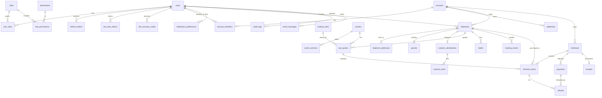

# Database Design (PostgreSQL)

Conventions: `id UUID PRIMARY KEY` (UUIDv7, app-generated) unless noted; every table has
`created_at TIMESTAMPTZ NOT NULL DEFAULT now()` and `updated_at TIMESTAMPTZ NOT NULL`
(maintained by SQLAlchemy). Money = `BIGINT` minor units + `currency CHAR(3)`.
Enums are PostgreSQL `TEXT` with `CHECK` constraints (easier to migrate than native enums).
Extensions: `citext`, `pg_trgm` (shipment search).

## 1. ERD (MVP)

## 2. Tables (MVP)

### Identity
**users**
| Column | Type | Notes |
|---|---|---|
| email | CITEXT | UNIQUE, NOT NULL |
| password_hash | TEXT | Argon2id |
| first_name, last_name | TEXT | |
| phone | TEXT | E.164, nullable |
| locale | TEXT | CHECK in (`en`,`fr-CA`,`es-419`) |
| country | CHAR(2) | `US`/`CA` |
| timezone | TEXT | IANA |
| email_verified_at | TIMESTAMPTZ | |
| mfa_enabled | BOOLEAN | default false |
| mfa_secret_enc | BYTEA | encrypted TOTP secret |
| is_staff | BOOLEAN | default false |
| status | TEXT | `active`/`suspended`/`deleted` |
| failed_login_count, locked_until | INT, TIMESTAMPTZ | |
| last_login_at, deleted_at | TIMESTAMPTZ | |
Indexes: `status`.

**roles** (`code` UNIQUE, `name`), **permissions** (`code` UNIQUE, `description`),
**role_permissions** (PK `role_id, permission_id`), **user_roles** (PK `user_id, role_id`). All FKs
`ON DELETE CASCADE`.

**refresh_tokens**: `user_id` FK, `family_id UUID`, `token_hash BYTEA UNIQUE`, `expires_at`,
`absolute_expires_at`, `revoked_at`, `replaced_by_id` FK self, `ip INET`, `user_agent`.
Index `(user_id)`, `(family_id)`.

**one_time_tokens**: `user_id` FK, `purpose` (`verify_email`/`reset_password`/`mfa_login`),
`token_hash BYTEA UNIQUE`, `expires_at`, `used_at`.

**mfa_recovery_codes**: `user_id` FK, `code_hash`, `used_at`.

### Accounts
**accounts**: `type` (`individual`/`business`), `name`, `country CHAR(2)`,
`default_currency CHAR(3)`, `status`, `payment_customer_ref` (Stripe customer id, UNIQUE
nullable), `billing_address_id` FK → addresses (nullable, `DEFERRABLE`).

**account_members**: PK `(account_id, user_id)`, `role` (`owner`/`admin`/`shipper`/`viewer`).

**addresses**
| Column | Type | Notes |
|---|---|---|
| account_id | UUID FK | NOT NULL, `ON DELETE CASCADE` |
| nickname | TEXT | |
| name, company | TEXT | name or company required (CHECK) |
| street1, street2, city | TEXT | |
| region | TEXT | state/province code |
| postal_code | TEXT | normalized upper, no spaces for CA |
| country | CHAR(2) | |
| phone, email | TEXT | |
| is_residential | BOOLEAN | |
| verified_at | TIMESTAMPTZ | |
| verification_ref | TEXT | provider address id |
| is_default_sender | BOOLEAN | partial UNIQUE `(account_id) WHERE is_default_sender` |
| deleted_at | TIMESTAMPTZ | soft delete |
Index `(account_id) WHERE deleted_at IS NULL`.

**notification_preferences**: PK `(user_id, event_type, channel)`, `enabled`.

### Shipping
**carriers**: `code` UNIQUE (`usps`,`ups`,`fedex`,`canada_post`,`purolator`,`canpar`…), `name`,
`is_enabled`, `capabilities JSONB` (can_void, void_window_days, supports_pickup…).

**carrier_services**: `carrier_id` FK, `code`, `name`, `is_enabled`; UNIQUE `(carrier_id, code)`.

**shipments**
| Column | Type | Notes |
|---|---|---|
| account_id | UUID FK | NOT NULL, `ON DELETE RESTRICT` |
| created_by_user_id | UUID FK | |
| reference | TEXT | UNIQUE, human id `VX-7K3M9Q2P` |
| status | TEXT | lifecycle (spec §3) |
| tracking_status | TEXT | normalized, nullable |
| is_test | BOOLEAN | NOT NULL |
| is_international | BOOLEAN | generated from addresses |
| signature_option | TEXT | `none`/`signature`/`adult_signature` |
| insured_amount, declared_value | BIGINT | + `currency CHAR(3)` |
| delivery_instructions, customer_reference | TEXT | |
| provider | TEXT | `easypost`/`mock` |
| provider_shipment_id | TEXT | UNIQUE nullable |
| carrier_id | UUID FK | set on purchase |
| service_code | TEXT | |
| tracking_number | TEXT | |
| estimated_delivery_at, label_purchased_at, delivered_at, voided_at | TIMESTAMPTZ | |
Indexes: `(account_id, created_at DESC)`, `(account_id, status)`, `(tracking_number)`,
`(status) WHERE status = 'purchased'` for poll jobs; trigram index on `reference`, `tracking_number`.

**shipment_addresses**: snapshot of the address at time of shipment. `shipment_id` FK CASCADE,
`role` (`from`/`to`/`return`), same address columns as `addresses`; UNIQUE `(shipment_id, role)`;
trigram index on `name`, index on `postal_code`.

**parcels**: `shipment_id` FK CASCADE, `position INT`, `length, width, height NUMERIC(8,2)`,
`dimension_unit` (`in`/`cm`), `weight NUMERIC(10,3)`, `weight_unit` (`oz`/`lb`/`g`/`kg`),
`predefined_package TEXT`. UNIQUE `(shipment_id, position)`. CHECK all > 0.

**customs_declarations**: `shipment_id` FK UNIQUE, `contents_type`
(`merchandise`/`gift`/`documents`/`sample`/`return`/`other`), `contents_explanation`,
`non_delivery_option` (`return`/`abandon`), `signer_name`, `certified_at`, `eel_pfc`.

**customs_items**: `declaration_id` FK CASCADE, `description`, `quantity INT > 0`,
`value_amount BIGINT`, `currency`, `weight`, `weight_unit`, `hs_tariff_code`, `origin_country CHAR(2)`, `sku`.

**rate_quotes**
| Column | Type | Notes |
|---|---|---|
| shipment_id | UUID FK | CASCADE |
| source | TEXT | `easypost`/`mock` |
| provider_rate_id | TEXT | |
| carrier_id | UUID FK | |
| service_code, service_name | TEXT | |
| cost_amount | BIGINT | what we pay |
| markup_amount | BIGINT | |
| price_amount | BIGINT | what the customer pays (pre-tax) |
| currency | CHAR(3) | |
| markup_rule_id | UUID FK | nullable |
| delivery_days | INT | nullable |
| estimated_delivery_date | DATE | nullable |
| delivery_guaranteed | BOOLEAN | |
| is_test | BOOLEAN | |
| expires_at | TIMESTAMPTZ | index |
| superseded_at | TIMESTAMPTZ | set when shipment edited |
CHECK `price_amount = cost_amount + markup_amount`.

**markup_rules**: `name`, `priority INT`, `carrier_id` FK nullable, `service_code` nullable,
`origin_country`/`destination_country` nullable, `account_id` FK nullable (negotiated rates
later), `percent NUMERIC(6,3)`, `fixed_amount BIGINT`, `currency`, `min_markup`, `max_markup`,
`is_active`, `valid_from`, `valid_to`. Index `(is_active, priority)`.

**labels**: `shipment_id` FK, `format` (`pdf`/`png`/`zpl`), `size` (`4x6`/`letter`),
`storage_key TEXT`, `provider_url TEXT`, `is_test`. UNIQUE `(shipment_id, format, size)`.

**tracking_events**: `shipment_id` FK CASCADE, `occurred_at`, `status` (normalized),
`provider_status`, `description`, `city`, `region`, `country`, `postal_code`, `source`
(`webhook`/`poll`), `dedupe_hash TEXT`. UNIQUE `(shipment_id, dedupe_hash)`; index
`(shipment_id, occurred_at DESC)`.

### Payments
**checkouts**
| Column | Type | Notes |
|---|---|---|
| account_id | UUID FK | RESTRICT |
| user_id | UUID FK | |
| status | TEXT | spec §5 |
| currency | CHAR(3) | single currency per checkout |
| subtotal_amount, tax_amount, total_amount | BIGINT | CHECK total = subtotal + tax |
| captured_amount | BIGINT | default 0 |
| tax_calculation_ref | TEXT | Stripe Tax calc id |
| idempotency_key | TEXT | UNIQUE `(account_id, idempotency_key)` |
| is_test | BOOLEAN | |
| expires_at, completed_at | TIMESTAMPTZ | |

**checkout_items**: `checkout_id` FK CASCADE, `shipment_id` FK, `rate_quote_id` FK,
`price_amount`, `tax_amount`, `status` (`pending`/`purchased`/`failed`/`refunded`),
`failure_code`. UNIQUE `(checkout_id, shipment_id)`. Partial UNIQUE `(shipment_id) WHERE
status = 'purchased'`, which makes it impossible at the DB level to buy two labels for one shipment.

**payments**: `checkout_id` FK, `provider` (`stripe`/`paypal`/`mock`), `provider_payment_id`
UNIQUE, `status` (`requires_action`/`authorized`/`captured`/`partially_captured`/`cancelled`/`failed`),
`amount_authorized`, `amount_captured`, `currency`, `payment_method_summary` (e.g. "Visa •••• 4242"),
`failure_code`.

**refunds**: `payment_id` FK, `checkout_item_id` FK nullable, `amount BIGINT > 0`, `currency`,
`reason`, `status` (`pending`/`succeeded`/`failed`), `provider_refund_id` UNIQUE nullable,
`requested_by_user_id` FK. App-level check: sum of refunds ≤ captured amount (enforced under row lock).

**receipts**: `checkout_id` FK UNIQUE, `number TEXT UNIQUE` (sequence `R-2026-000123`),
`locale`, `storage_key`.

### Platform
**webhook_events** (`BIGSERIAL` id): `provider`, `event_id`, `event_type`, `payload JSONB`,
`received_at`, `processed_at`, `attempts`, `last_error`. UNIQUE `(provider, event_id)`.

**idempotency_records**: `scope` (user/account id), `key`, `request_hash`, `status_code`,
`response_body JSONB`, `locked_until`, `expires_at`. UNIQUE `(scope, key)`.

**audit_logs** (`BIGSERIAL`, append-only; app role has INSERT/SELECT only): `actor_user_id`
nullable, `actor_type` (`user`/`staff`/`system`), `action` (e.g. `shipment.void`), `entity_type`,
`entity_id`, `ip INET`, `user_agent`, `metadata JSONB`, `created_at`. Index `(entity_type,
entity_id)`, `(actor_user_id, created_at DESC)`, `(created_at)`.

**email_messages**: `user_id` FK nullable, `to_address`, `template`, `locale`, `status`,
`provider_message_id`, `sent_at`, `error`.

**rate_limit_counters**: PK `(bucket, key, window_start)`, `count`. Pruned hourly.

**system_settings**: `key TEXT PK`, `value JSONB`, `updated_by_user_id`, `updated_at`.

**procrastinate_*** tables are owned by the job library and created by its own migration step.

## 3. Deletion rules

- Financial and shipment rows use `ON DELETE RESTRICT`; accounts are never hard-deleted while
  they own shipments. Account closure anonymizes PII columns instead.
- Child rows that have no meaning alone (parcels, shipment_addresses, tracking_events) use `CASCADE`.
- Addresses are soft-deleted (`deleted_at`) because shipments snapshot their own copy.

## 4. Later-phase tables (planned, not built in MVP)

| Phase | Tables |
|---|---|
| 3 Store | `product_categories`, `products`, `product_variants`, `product_images`, `inventory_items`, `inventory_movements`, `carts`, `cart_items`, `orders`, `order_items`, `coupons`, `coupon_redemptions` |
| 4 Finance | `invoices`, `invoice_lines`, `account_statements`, `credit_notes` |
| 5 Advanced | `business_profiles`, `account_invitations`, `shipment_imports`, `shipment_import_rows`, `returns`, `pickups`, `manifests`, `api_keys`, `integration_connections`, `support_tickets`, `support_messages` |
| 6 Warehouse | `warehouses`, `warehouse_locations`, `warehouse_inventory`, `inbound_receipts`, `scans`, `consolidations`, `dispatches` |

These all attach to existing `accounts`, `users`, `shipments` and `payments`, so no MVP table
needs restructuring. `checkouts` can later hold store orders through a generic line-item
type, or orders get their own table; that decision is deferred to Phase 3.
